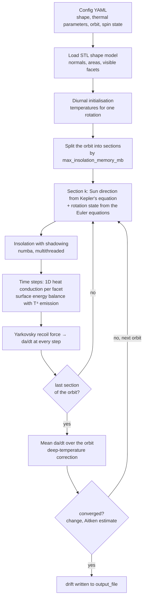
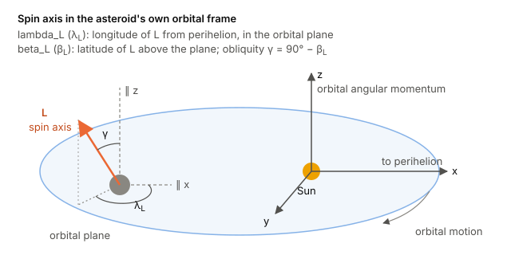
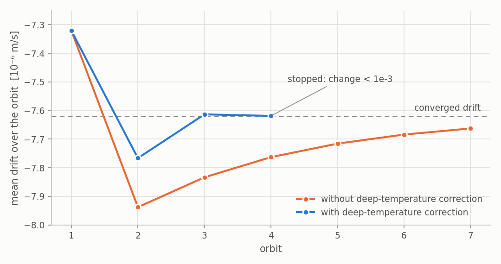
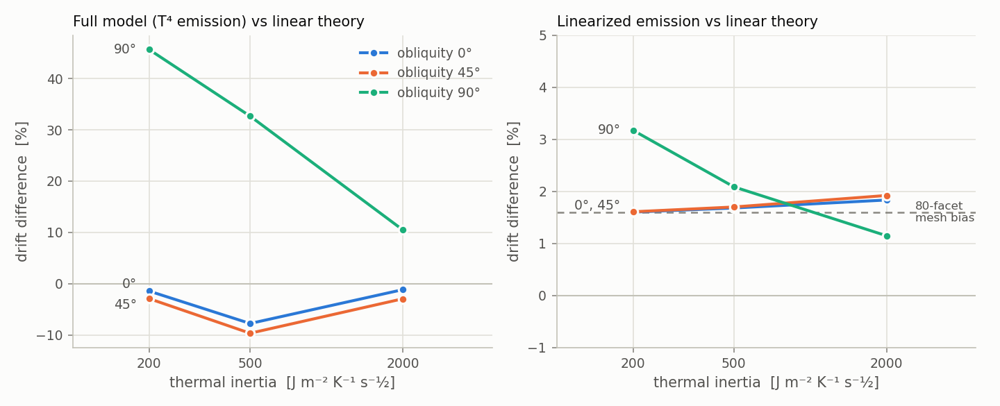
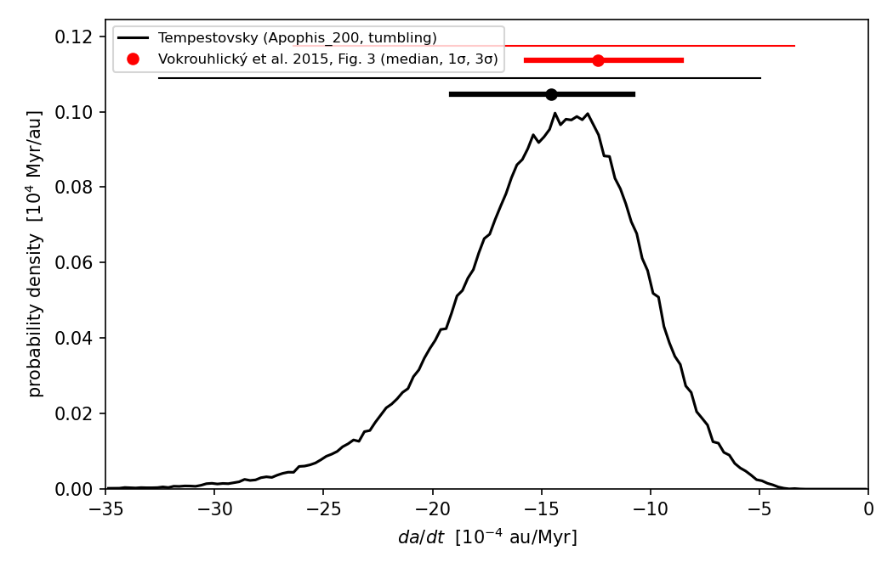

# TEMPEST-Yarkovsky

**Thermophysical Yarkovsky drift for asteroids of arbitrary shape and rotation state, including tumbling (non-principal-axis) rotators.**

This repository is a modified version of [TEMPEST](https://github.com/duncanLyster/TEMPEST) by Duncan Lyster, Howett, and Penn. It contains substantial modifications and extensions for the calculation of the Yarkovsky effect for tumbling and non-principal-axis rotating asteroids, developed by Dušan Marčeta and contributors. The Yarkovsky solvers are called **Tempestovsky**.

For a shape model, thermal parameters, an orbit and a rotation state, the model gives the orbit-averaged drift of the semi-major axis, $\langle da/dt \rangle$. It solves the full nonlinear surface energy balance on every facet, with shadowing and the true orbital geometry. No linearization is applied unless you ask for it.

---

## Contents
- [What it does](#what-it-does)
- [How it works](#how-it-works)
- [Geometry and rotation state](#geometry-and-rotation-state)
- [Physics](#physics)
- [Convergence of the drift](#convergence-of-the-drift)
- [Validation](#validation)
- [Quick start](#quick-start)
- [Configuration reference](#configuration-reference)
- [Repository layout](#repository-layout)
- [License and attribution](#license-and-attribution)

---

## What it does

| | |
|---|---|
| **Shape** | any triangulated STL model (spheres, Apophis radar model at 200 to 3996 facets, …) |
| **Rotation** | fixed-axis rotation, or torque-free tumbling with integrated Euler equations |
| **Orbit** | Keplerian, any eccentricity; the spin axis is given in the asteroid's own orbital frame |
| **Heat conduction** | 1D per facet, explicit or implicit (Crank-Nicolson) time stepping |
| **Surface** | nonlinear $T^4$ emission, cast shadows, optional self-heating between facets |
| **Yarkovsky force** | Lambertian thermal recoil summed over facets, converted to $da/dt$ with Gauss' equations |
| **Convergence** | the orbit is repeated until the drift converges, not for a preset number of orbits |
| **Linear-theory mode** | optional linearized emission for direct comparison with the analytic theory of Vokrouhlický |

---

## How it works



The rotation and thermal state carry over continuously from one section to the next and from one orbit to the next. The insolation is precomputed only one section at a time, so memory use does not depend on the length of the orbit.

---

## Geometry and rotation state

<p align="center"></p>

All directions are given in **the asteroid's own orbital frame**: x points towards perihelion and z along the orbital angular momentum. The drift depends only on how the spin axis is oriented relative to the asteroid's own orbit, so the ecliptic, the inclination and the node never enter. Ecliptic pole coordinates must be converted once to this frame before they are put in a config. For example, the Apophis pole (250°, −75°) becomes `lambda_L: 269.222`, `beta_L: -77.201`, which is an obliquity of 167.2°.

The rotation state is given by the angular momentum direction **L** and the Euler-angle parameters:

| key | meaning |
|---|---|
| `lambda_L`, `beta_L` | direction of the angular momentum L (orbital frame); obliquity $\gamma = 90^\circ - \beta_L$ |
| `I1`, `I2` | moments of inertia, with $I_3 = 1$ (long-axis or short-axis mode follows from the values) |
| `E_ratio` | $2 I_3 E / L^2$; `1.0` gives rotation about a fixed axis, `> 1` gives tumbling |
| `P_phi_h` | **mean** precession period of the Euler angle $\varphi$ [h]; the initial angular velocity is rescaled so that the mean equals this value |
| `phi_0`, `psi_0` | initial Euler angles [deg] |

For `E_ratio: 1.0` and `I1 = I2 = 0.5` the body rotates about a fixed axis with period $P = 2\,P_{\varphi}$. The torque-free Euler equations are integrated with DOP853 (`rtol = 1e-11`). The shape model is taken to be in the principal-axis frame (x = $I_1$, y = $I_2$, z = $I_3$).

---

## Physics

**Heat conduction** in every facet, with an insulating bottom:

$$\rho c\,\frac{\partial T}{\partial t} = k\,\frac{\partial^2 T}{\partial z^2},\qquad \left.\frac{\partial T}{\partial z}\right|_{z=L} = 0 .$$

**Surface energy balance**, with insolation $E(t)$ including cast shadows:

$$(1-A)\,E(t) + k\left.\frac{\partial T}{\partial z}\right|_{0} = \varepsilon\sigma T_0^4 .$$

**Yarkovsky force** (Lambertian thermal recoil, summed over facets with normals $\hat n_i$ and areas $A_i$):

$$\mathbf F = -\frac{2}{3}\,\frac{\varepsilon\sigma}{c}\sum_i T_i^4\,A_i\,\hat{\mathbf n}_i ,$$

projected onto the radial direction ($R$) and the transverse direction ($B$), and converted with Gauss' equation

$$\frac{da}{dt} = \frac{2}{n\sqrt{1-e^2}}\,\frac{1}{m}\left(R\,e\sin\nu + B\,\frac{a(1-e^2)}{r}\right),$$

which is averaged over the orbit.

### Solvers

| `temp_solver` | time integration | notes |
|---|---|---|
| `tempestovsky` | explicit FTCS | stable only for $\kappa\,\Delta t/\Delta z^2 \lesssim 0.25$, so it needs very small time steps |
| `tempestovsky_implicit` | θ-scheme, Crank-Nicolson by default | unconditionally stable; one tridiagonal sweep per facet and step; the surface $T^4$ is solved exactly with Newton's method |

In both solvers the surface node holds half a layer (finite volume). In the implicit solver the insolation is time-centred like the other terms, which keeps Crank-Nicolson second order in time.

### Linearized emission (comparison with linear theory)

With `linearized_emission: true` (implicit solver), the emission is replaced by its first-order Taylor expansion around a reference temperature $T_0$, both in the energy balance and in the recoil force:

$$\varepsilon\sigma T^4 \;\rightarrow\; \varepsilon\sigma\left(T_0^4 + 4T_0^3\,(T - T_0)\right),\qquad T_0 = T_\star/\sqrt{2},\quad \varepsilon\sigma T_\star^4 = \frac{(1-A)L_\odot}{4\pi r^2}.$$

$T_0$ follows the current heliocentric distance $r$. This choice is the one consistent with the linear theory. The difference between the full and the linearized run is then purely the effect of the $T^4$ nonlinearity.

---

## Convergence of the drift

There is no preset number of spin-up orbits. The orbit is **repeated, with the state carried over, until the orbit-averaged drift converges**:

- **Stopping criterion.** The run stops when the change of the drift between two orbits (or, once the drift converges geometrically, the error estimated by Aitken extrapolation) falls below `max(yarkovsky_tolerance·|drift|, yarkovsky_abs_tolerance)`.
- **Deep-temperature correction.** In the periodic steady state, the time-averaged heat equation gives $d^2\langle T\rangle/dz^2 = 0$. With an insulating bottom, the mean temperature is therefore the same at every depth and equal to the mean surface temperature. After each orbit every layer is shifted by $\langle T_\text{surface}\rangle - \langle T(z)\rangle$. This shift is zero in the steady state, and it removes the slow relaxation of the deep layers, whose timescale is $\sim 4L^2/\pi^2\kappa$, i.e. years.

<p align="center">
  <picture>
    <source media="(prefers-color-scheme: dark)" srcset="documentation/readme/convergence_dark.png">
    
  </picture>
</p>

<sub>80-facet sphere, TI 2500, a = 1 au, obliquity 90°. The dashed line is the Aitken limit of the uncorrected run; the corrected run reaches it within 0.006%.</sub>

The output file lists the drift of every orbit, the extrapolated drift, the error estimate and whether the run converged:

```text
drift (m/s): -7.618827773659452e-06
drift last orbit (m/s): -7.618827773659452e-06
drift extrapolated (m/s): None
estimated error (m/s): 5.349e-09
converged: True
orbits: 4
orbit 1: -7.320841979966318e-06
...
```

---

## Validation

### Against the linear theory (Vokrouhlický)

Fixed-axis rotation, 80-facet sphere, circular orbit at a = 0.5 au, P = 12 h, for obliquities 0°, 45° and 90°. The full grid also has P = 4 and 24 h and is in [`results/linear_comparison`](results/linear_comparison).

<p align="center">
  <picture>
    <source media="(prefers-color-scheme: dark)" srcset="documentation/readme/validation_dark.png">
    
  </picture>
</p>

- **Linearized emission vs linear theory:** +1.2 to +1.9 % over the whole grid, which is the size of the 80-facet mesh bias of +1.6 %. One exception is obliquity 90° at low thermal inertia, where the difference grows with the rotation period to +4.4 % at P = 24 h.
- **Full model vs linear theory:** −10 to +3 % for obliquities 0° and 45°, and +10 to +46 % for 90° (pure seasonal effect). This is the effect of the $T^4$ nonlinearity, which the linear theory leaves out.

### Apophis

The drift distribution of (99942) Apophis was computed with the tumbling radar shape model (`Apophis_200.stl`), compared with Fig. 3 of Vokrouhlický et al. (2015). See [`results/apophis_fig3`](results/apophis_fig3).

<p align="center"></p>

| | median | 1σ interval |
|---|---|---|
| Tempestovsky (pure, tumbling) | −14.5 × 10⁻⁴ au/Myr | [−19.1, −10.8] |
| Vokrouhlický et al. (2015) | −12.4 × 10⁻⁴ au/Myr | [−15.7, −8.6] |

---

## Quick start

```bash
git clone https://github.com/dusanmarceta/Jarkovsky-Tumbling.git
cd Jarkovsky-Tumbling
git checkout tumbling

conda create -n tempest python=3.10
conda activate tempest
pip install -r requirements.txt

# fixed-axis sphere, compared with linear theory in Vokrouhlicky model/
python tempest.py --config data/config/config_vokrouhlicky_test.yaml

# Apophis orbit and tumbling state (80-facet sphere in this config;
# set shape_model_file: "Apophis_200.stl" for the radar shape)
python tempest.py --config data/config/config_apophis.yaml
```

Progress goes to the console and to `progress_file`. The result is written to `output_file`, as in the example above.

The linear theory is in [`Vokrouhlicky model/`](Vokrouhlicky%20model): `yarko_eccentric(a, e, rho, k, c, R, gamma, P_h, 1-A, eps, 0)` returns the drift in m/s.

---

## Configuration reference

The Yarkovsky-specific keys are listed below. All other keys (shape model, shadowing, scattering, plotting) are inherited from TEMPEST.

| key | default | meaning |
|---|---|---|
| `temp_solver` | | `tempestovsky` (explicit) or `tempestovsky_implicit` |
| `thermal_inertia`, `density`, `specific_heat_capacity` | | thermal parameters (SI) |
| `emissivity`, `albedo` | | surface parameters |
| `n_skin_depths`, `n_layers` | | depth of the 1D grid in diurnal skin depths, and number of layers; cover a few **seasonal** skin depths |
| `implicit_timesteps_per_day` | 200 | steps per rotation (implicit solver) |
| `implicit_theta` | 0.5 | 0.5 is Crank-Nicolson, 1.0 is backward Euler |
| `a_au`, `ecc` | | orbit |
| `lambda_L`, `beta_L` | | spin axis (L) in the orbital frame [deg] |
| `I1`, `I2`, `E_ratio`, `P_phi_h`, `phi_0`, `psi_0` | | rotation state, see [above](#geometry-and-rotation-state) |
| `version` | | `new` uses the integrated Euler equations (tumbling), `old` uses simple rotation about L |
| `yarkovsky_tolerance` | 1e-3 | relative tolerance of the orbit-averaged drift |
| `yarkovsky_abs_tolerance` | 0 | absolute tolerance [m/s], useful when the drift is close to zero |
| `yarkovsky_extrapolate` | true | report the Aitken-extrapolated drift when it is available |
| `deep_temperature_correction` | true | shift the subsurface to the steady-state mean after each orbit |
| `min_orbits`, `max_orbits` | 4, 20 | limits on the number of orbits |
| `orbital_initialisation` | 0 | optional extra spin-up, in orbits, before the first measured orbit |
| `max_insolation_memory_mb` | 500 | memory limit for the insolation precomputed per orbit section; sets the number of sections |
| `linearized_emission` | false | linearize the $T^4$ emission (implicit solver) |
| `linearization_temperature` | `T_av` | `T_av` = $T_\star/\sqrt2$, `T_star`, or a number in K |
| `output_file`, `progress_file` | | result and progress log |

---

## Repository layout

```text
tempest.py                       entry point (python tempest.py --config <file>)
src/model/solvers/
    tempestovsky.py              Yarkovsky solver: orbit loop, convergence, recoil force
    tempestovsky_implicit.py     implicit (Crank-Nicolson) heat conduction, linearized emission
src/model/insolation.py          insolation per orbit section, shadowing (numba)
src/model/simulation.py          parameters, rotation state, time step
src/utilities/tumbling_final_2.py  Euler equations, body/orbit frame rotations
data/config/                     configuration files (config_apophis*.yaml, config_vokrouhlicky_test.yaml, …)
data/shape_models/               STL shape models (spheres, Apophis_200/500/1000/3996)
Vokrouhlicky model/              analytic linear Yarkovsky theory, for validation
results/linear_comparison/       grid comparison with linear theory
results/apophis_fig3/            Apophis drift distribution (Fig. 3)
documentation/readme/            figures of this README (make_figures.py)
```

---

## License and attribution

Modified MIT License with attribution requirements, see [LICENSE.md](LICENSE.md). If you use this software, cite the original TEMPEST model:

> Lyster, D., Howett, C., & Penn, J. (2025). *TEMPEST: A Modular Thermophysical Model for Airless Bodies with Support for Surface Roughness and Non-Periodic Heating.* EPSC-DPS Joint Meeting 2025.

The Yarkovsky extensions (Tempestovsky solvers, tumbling rotation, drift convergence) are by Dušan Marčeta and contributors.
